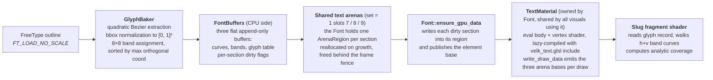

# Text plugin

The text plugin (`velk_text`) brings font loading and text rendering support into velk-ui. Loaded automatically by the runtime; no manual setup needed.

## Contents
- [Approach](#approach)
- [Usage](#usage)
- [Drawing text](#drawing-text)
  - [TextVisual](#textvisual)
  - [TextField](#textfield)
  - [TreeView](#treeview)
- [JSON declaration](#json-declaration)
  - [Font size](#font-size)
- [How it works](#how-it-works)
  - [Pipeline](#pipeline)
  - [GPU data layout](#gpu-data-layout)
  - [Coordinate convention](#coordinate-convention)
- [Performance](#performance)
  - [Batching](#batching)
- [Future improvements](#future-improvements)
- [Classes](#classes)


## Approach

The text plugin (`velk_text`) renders text using **analytic Bezier glyph coverage**, adapted from Eric Lengyel's public-domain [Slug](https://github.com/EricLengyel/Slug) reference shaders (see `/velk-ui/plugins/text/src/embedded/velk_text_glsl.h` for the GLSL source). 

Instead of a traditional glyph atlas, glyphs are extracted once with FreeType, packed into GPU-resident curve and band buffers, and shaded per-pixel by a fragment shader that computes exact analytic coverage of every Bezier inside the sample's footprint. 

The same font instance can render at any pixel size without re-baking, with sub-pixel anti-aliasing computed from the curve geometry directly, as shown in the following screen capture:


In typical situations this approach offers very acceptable performance, see [performance chapter](#performance) for more details.

## Usage

The plugin is loaded automatically by `velk::create_app()`. Its `initialize()` registers `Font`, `TextMaterial`, `TextVisual` and the `font` resource decoder, and loads two built-in fonts: Inter Regular (the default) and JetBrains Mono Regular (monospace). They are returned by `velk::ui::get_default_font()` and `velk::ui::get_monospace_font()`.

If you're not using the runtime, load it manually:

```cpp
velk::instance().plugin_registry().load_plugin_from_path("velk_text.dll");
```

## Drawing text

### TextVisual

Attach a `TextVisual` to any element. By default the visual uses the shared default font.

```cpp
#include <velk-scene/api/element.h>
#include <velk-ui/plugins/text/api/text_visual.h>

using namespace velk::ui;

auto element = create_element();
auto text    = trait::visual::create_text();

text.set_text("Hello, Velk");
text.set_font_size(24.f);
text.set_color(color::white());

element.add_trait(text);
```

The visual shapes the text with HarfBuzz on every change to `text` or `font_size`, lazy-bakes any glyphs it hasn't seen before, and emits one quad per laid-out glyph. All quads in one text element share a single draw call.

### TextField

`TextField` is a single-line editable text: a text visual and an input trait in one attachment. It has the `ITextVisual` properties and `ITextField`:

| Member | Description |
|---|---|
| `editing` (read-only) | True while the field takes typed text. |
| `on_commit(string text)` | An edit changed `text`. |

Clicking the field focuses it and starts editing, with the caret at the click. Typed text goes to an edit buffer; `text` keeps its value until the edit is committed. Enter or clicking elsewhere commits, Escape restores the buffer from `text`. Backspace, Delete, Left, Right, Home and End edit and move the caret. Text is left aligned (`v_align` applies). Text wider than the field scrolls to keep the caret in view. The field is a clip (see [Clipping](../ui/traits.md#clipping)), so the text is cut at its edges.

```json
{ "targets": ["name"], "class": "velk-text.TextField", "properties": { "text": "Panel", "v_align": "center" } }
```

Not yet: selection, clipboard, IME, multiple lines, a blinking caret, Tab between fields.

### TreeView

`TreeView` shows a velk object hierarchy as rows. Set `source` to an `IHierarchy`; each object's `label_property` (`label` by default) is its text. The root starts expanded. Clicking the `+` or `-` in front of a row expands or collapses it, and clicking elsewhere on a row sets `selected` to its object. The rows follow the hierarchy's changes.

| Property | Description |
|---|---|
| `source` | The `IHierarchy` shown. |
| `label_property` | The property shown as each object's text. |
| `selected` | The selected object, or none. |
| `row_height`, `indent`, `font_size` | Row height, indentation per level and text size, in pixels. |
| `selection_color` | Background of the selected row. The text has the visual's `color`. |

Its content size is its rows, so in a `ScrollView` with an `auto` height it scrolls. Every shown row is drawn; the scroll view clips the rest.

```json
{ "targets": ["tree"], "class": "velk-ui.FixedSize", "properties": { "height": "auto" } },
{ "targets": ["tree"], "class": "velk-text.TreeView", "properties": { "color": { "r": 0.9, "g": 0.9, "b": 0.9, "a": 1.0 } } }
```

The source is set in code, since a store file cannot name a hierarchy:

```cpp
velk::write_state<velk::ui::ITreeView>(tree, [&](velk::ui::ITreeView::State& s) {
    velk::set_object_ref(s.source, hierarchy.as_ptr<velk::IObject>());
});
```

Not yet: keyboard navigation, rows made only for what shows (virtualization), a data source other than a velk hierarchy.

## JSON declaration

A `TextVisual` trait can be added as an attachment to one or more `Element` to render text:

```json
{
  "targets": ["card_title"],
  "class": "velk_text.TextVisual",
  "properties": {
    "text": "Total Users",
    "font_size": 32.0,
    "h_align": "left",
    "v_align": "center",
    "color": { "r": 0.85, "g": 0.85, "b": 0.9, "a": 1.0 }
  }
}
```

`text`, `font`, `font_size`, `h_align`, and `v_align` are all standard properties. `color` lives on the `IVisual2D` interface shared by all 2D visuals.

### Fonts

Fonts are resources. The `font` decoder loads a TrueType or OpenType file from any protocol:

```cpp
auto& store = velk::instance().resource_store();
velk::ui::Font font(store.get_resource<velk::ui::IFont>("font:app://fonts/Inter-Bold.ttf"));
text.set_font(font);
```

Loading is synchronous and deduplicated by URI. Glyphs are baked when first drawn.

In a scene file, declare the font as a resource and reference it from the `font` property:

```json
"resources": [
  { "id": "bold", "uri": "font:app://fonts/Inter-Bold.ttf" }
],
"attachments": [
  { "targets": ["title"], "class": "velk-text.TextVisual",
    "properties": { "text": "Title", "font": { "ref": "resources.bold" } } }
]
```

The built-in fonts are available as `font:memory://velk-text/Inter-Regular.ttf` and `font:memory://velk-text/JetBrainsMono-Regular.ttf`.

When `font` is empty, or the font failed to load (its `IResource::exists()` returns false), the visual uses the default font.

### Font size

`font_size` is a property of the visual, not the font. The font is **fully scale-independent**: glyph outlines are baked once with `FT_LOAD_NO_SCALE` and normalized to `[0, 1]^2` per glyph; HarfBuzz is configured at init so shaping advances come back in font units; metrics are exposed in font units. The visual computes `scale = font_size / units_per_em` and applies it to advances, glyph offsets, bbox extents, ascender, and line height when emitting per-glyph quads.

Practical consequences:

  * The same `Font` instance can serve any pixel size with no re-baking and no extra memory.
  * Many `TextVisual`s sharing one font can each draw at a different size simultaneously.
  * Changing `font_size` at runtime triggers a reshape but does not touch the font's GPU buffers.
  * Quality stays exact at any size (the shader walks the actual curve geometry, not a sampled approximation).

## How it works

### Pipeline



Glyph baking is **lazy and append-only**: The first time a glyph_id is referenced, the font
  * extracts its outline
  * packs the curves and bands and 
  * appends the data to the GPU buffers.

Subsequent references return the cached entry.

### GPU data layout

  * **Curve buffer**: array of `QuadCurve { vec2 p0, p1, p2 }`, 24 bytes each. Curves are normalized to `[0, 1]^2` over each glyph's bbox so the shader's uv (also in `[0, 1]`) can be used directly.
  * **Band buffer**: flat `uint32_t[]`. Per glyph, the layout starting at `band_data_offset` is:

        h_offsets[N+1]   prefix sums into the h curve index list
        h curve indices  uint32_t each, glyph-relative
        v_offsets[N+1]
        v curve indices

    where `N = BakedGlyph::BAND_COUNT = 8`. Curves within each band are sorted descending by their max coordinate on the orthogonal axis, so the shader can early-exit once a curve falls outside the sample's footprint.
  * **Glyph table**: array of `GlyphRecord` (32 bytes), one per baked glyph. Holds bbox in font units, curve_offset, curve_count, band_data_offset.
  * **Per-instance**: the universal `ElementInstance` (128 bytes), one per glyph quad. `offset` carries the glyph's position, `size` its extents, `col` its colour, and `params[0]` the glyph index. Text uses no instance type of its own.
  * **Per-material data**: `TextMaterialData`, three `uint32_t` element bases (curves, bands, glyph table) into the font's regions of the three shared text arenas, plus padding to 16 bytes. It lives in the material arena like any other material record, and the shader passes the three bases into `velk_text_coverage`, which indexes the arenas directly.

The three sections are shared arenas rather than per-font buffers, so a scene with many fonts still binds three descriptors, and the font's data leaves the per-frame upload sweep entirely. A font that bakes new glyphs reallocates its region and marks its material dirty so the new bases are republished.

For printable ASCII rendered with Inter, the entire per-font upload is about 92 KB (48 KB curves, 41 KB bands, 3 KB glyph table). This scales linearly with the number of unique glyphs actually used.

### Coordinate convention

The baker normalizes curves to `[0, 1]^2` over the bbox in FreeType's Y-up convention (descender at y = 0, ascender at y = 1). The vertex shader flips quad uv to match: `v_uv = vec2(q.x, 1.0 - q.y)`. The fragment shader and `velk_text_coverage` operate in this Y-up glyph normalized space.

## Performance

The fragment shader for text runs an inside-test for every pixel:
* walks a small list of Bezier curves and 
* computes a polynomial root. 

The analytic coverage shader keeps per-pixel cost bounded regardless of font size, and the band acceleration structure limits curve tests to a small subset per pixel (typically 6 to 16 for Latin glyphs).

So what kind of performance is possible? The screenshot below shows a stress test use case with 10 overlapping text blocks (each a full paragraph over 1000 characters of lorem ipsum with varying text size and color) rendering over 11,000 glyphs per frame at above 3,000 fps (no buffering to texture etc). 


(captured on a desktop PC with an AMD Ryzen 5800X and an AMD Radeon RX9070XT)

### Batching

All `TextVisual` instances sharing the same font share a single `TextMaterial`, which the renderer uses as its batching key. This means that in an optimal case the renderer can collapse all `TextVisual` instances using the same font into a single draw call, regardless of the font size, color or text defined in each visual.

In the RenderDoc capture below, all 11,601 glyph quads across every text block (each with different font size and color) are drawn in one instanced draw call. There is no per-element or per-line overhead; the GPU sees one vertex shader invocation per glyph quad with the glyph index passed via the instance buffer.


If a different visual type (e.g. a `RoundedRectVisual`) appears between two text visuals in the draw order, the batch is split because the renderer must switch materials to preserve correct layering.

## Future improvements

  * Only TTF is supported currently, to be added: CFF / OTF (cubic outlines)
  * Even-odd fill rule (Lengyel's `SLUG_EVENODD`)
  * Optical weight boost (Lengyel's `SLUG_WEIGHT`)
  * Subpixel hinting / LCD AA
  * CJK / very large glyph sets
  * Multi-font batching: visuals sharing a font already share a draw call (the Font owns one `TextMaterial` and visuals consume it), but mixing *different* fonts in one draw call is not supported.
  * Any-hit shader path for ray tracing

## Classes

Public ClassIds for the plugin's main types. Construct via `instance().create<I>(ClassId::...)` or use the header-only API wrappers in `velk-ui/plugins/text/api/`. See doxygen for full interface signatures.

| ClassId | Implements | Description |
|---|---|---|
| `velk::ui::ClassId::Font` | `IFont`, `IResource` | FreeType + HarfBuzz font instance, created by the `font` decoder. Shapes text and lazy-bakes glyphs into GPU curve / band / glyph buffers. Properties (in font units): `ascender`, `descender`, `line_height`, `units_per_em`. |
| `velk::ui::ClassId::FontDecoder` | `IResourceDecoder` | Decoder for `font:<uri>`. Registered by the plugin. |
| `velk::ui::ClassId::Visual::Text` | `ITextVisual`, `IVisual2D` | Text visual trait. Properties: `text`, `font`, `font_size`, `h_align`, `v_align`; `color` / `paint` from `IVisual2D`. Attaches to any element. |
| `velk::ui::ClassId::Visual::TextField` | `ITextField`, `ITextVisual`, `IVisual2D`, `IInputTrait`, `IFocusTarget`, `IClip` | Single-line editable text. See [TextField](#textfield). |
| `velk::ui::ClassId::Visual::TreeView` | `ITreeView`, `IVisual2D`, `IInputTrait` | Rows of a velk object hierarchy. See [TreeView](#treeview). |
| `velk::ui::ClassId::TextMaterial` | `IMaterial` | Material that runs the analytic-coverage fragment shader. Owned by each `Font` and shared by all `TextVisual`s using that font (so they batch into one draw call). Not normally constructed by user code. |

The plugin also exposes `ITextPlugin` (`velk-ui/plugins/text/intf_text_plugin.h`) via `PluginId::TextPlugin`, which provides `get_default_font()` and `get_monospace_font()`, usually accessed through the header-only helpers `velk::ui::get_default_font()` and `velk::ui::get_monospace_font()`.
